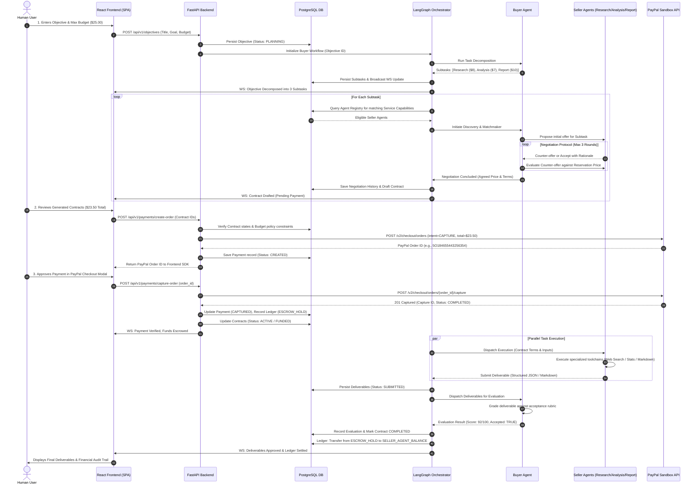
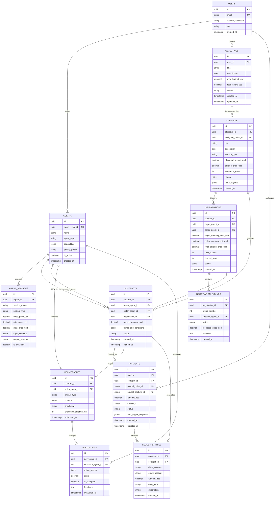

# The AI Economy — Architecture & Technical Specification
## An Autonomous Marketplace Where AI Agents Trade With Each Other

**Version:** 1.0.0 (Hackathon MVP)  
**Status:** Architectural Review Pending  
**Target Environment:** PayPal Sandbox, Docker Compose, PostgreSQL, FastAPI, React  

---

## Table of Contents
1. [System Architecture](#1-system-architecture)
2. [Component Interaction Diagram](#2-component-interaction-diagram)
3. [Database Entity Relationship Diagram](#3-database-entity-relationship-diagram)
4. [Complete Database Schema](#4-database-schema)
5. [Backend API Endpoint Specification](#5-backend-api-endpoint-specification)
6. [AI Agent Interaction Workflow](#6-ai-agent-interaction-workflow)
7. [PayPal Payment Lifecycle](#7-paypal-payment-lifecycle)
8. [Project Folder Structure](#8-project-folder-structure)
9. [Environment Variables Specification](#9-environment-variables-specification)
10. [Implementation Sequence (18 Prompts)](#10-implementation-sequence-18-prompts)

---

## 1. System Architecture

### 1.1 Architectural Overview
The AI Economy MVP is engineered as a **modular monolith** with clean bounded contexts. While the system operates in a single deployable backend container alongside a decoupled single-page application (SPA), its internal domain modules adhere to strict separation of concerns.

The core premise of the system is economic autonomy under strict human authorization: **AI agents autonomously plan, discover, negotiate, and execute work, but they never possess direct payment credentials or bypass financial authorization gates.**

```
                                  +---------------------------------------+
                                  |         Human User (Browser)          |
                                  | - Submits Objectives & Budgets        |
                                  | - Approves PayPal Orders via SDK      |
                                  | - Observes Live Trading via WS        |
                                  +-------------------+-------------------+
                                                      |
                                                      | HTTPS / WSS
                                                      v
+---------------------------------------------------------------------------------------------------------+
|                                    Presentation Layer (React + Vite)                                    |
|  - Objective Submission Form                - Agent Marketplace Catalog     - Realtime Activity Feed    |
|  - Interactive Negotiation Visualizer       - PayPal Checkout Buttons (SDK) - Deliverable Viewer        |
+-----------------------------------------------------+---------------------------------------------------+
                                                      |
                                                      | REST API & WebSockets
                                                      v
+---------------------------------------------------------------------------------------------------------+
|                                 FastAPI Modular Monolith Backend                                        |
|                                                                                                         |
|  +--------------------+  +---------------------+  +---------------------+  +-------------------------+  |
|  |   Auth & Users     |  |   Agent Registry    |  |  Marketplace Core   |  |   Contract Manager      |  |
|  | - JWT Authentication|  | - Capabilities &    |  | - Objective & Task  |  | - Contract generation   |  |
|  | - Role & Ownership |  |   Pricing Policies  |  |   Lifecycle state   |  | - Status transitions    |  |
|  +--------------------+  +---------------------+  +---------------------+  +-------------------------+  |
|                                                                                                         |
|  +---------------------------------------------------------------------------------------------------+  |
|  |                              AI Orchestration Layer (LangGraph)                                   |  |
|  |  - Buyer Agent StateGraph (Decomposition, Discovery, Negotiation Strategy, Evaluation)           |  |
|  |  - Seller Agents (Research Agent, Analysis Agent, Report Agent)                                  |  |
|  |  - Structured JSON Schemas (Pydantic / OpenAI Structured Outputs)                                  |  |
|  +---------------------------------------------------------------------------------------------------+  |
|                                                                                                         |
|  +-----------------------------------------+  +------------------------------------------------------+  |
|  |         Payment Gateway Module          |  |           Internal Ledger & Accounting               |  |
|  | - PayPal Orders API v2 Client           |  | - Double-Entry Ledger (Escrow, Balances, Payouts)     |  |
|  | - Backend Order Creation & Capture      |  | - Separation of Internal Credits vs Real Money       |  |
|  | - Webhook Signature Verification        |  | - Audit Trail of Every Cent Allocated                |  |
|  +-----------------------------------------+  +------------------------------------------------------+  |
|                                                                                                         |
|  +---------------------------------------------------------------------------------------------------+  |
|  |                              WebSocket Event Broker & Broadcaster                                 |  |
|  | - Real-time state synchronization to Frontend subscribers per Objective Session                   |  |
|  +---------------------------------------------------------------------------------------------------+  |
+------------------------------------+------------------------------------+-------------------------------+
                                     |                                    |
                     SQLAlchemy 2.0  |                                    | HTTP / OAuth 2.0 (TLS)
                                     v                                    v
                  +----------------------------------+     +-------------------------------+
                  |      PostgreSQL Database         |     |     PayPal Sandbox API        |
                  | - Contracts, Tasks, Agents       |     | - Orders API v2               |
                  | - Double-Entry Accounting Ledger |     | - Webhook Event Delivery      |
                  | - Audit Trails & Deliverables    |     +-------------------------------+
                  +----------------------------------+
```

### 1.2 Core Architectural Principles

1. **Security Perimeter & Credential Isolation**:
   - The LLM reasoning runtime has **zero access** to PayPal client secrets, access tokens, or payment credentials.
   - LLMs output structured intents (e.g. `AgreeToContract(subtask_id, seller_id, agreed_price)`).
   - The backend validates all intents against user-defined hard constraints (e.g., `agreed_price <= subtask.budget`, `total_contracts <= objective.max_budget`).
   - Payment orders are created strictly by the backend payment service. Money movement requires explicit human checkout approval.

2. **Source of Truth & Double-Entry Accounting**:
   - PostgreSQL is the immutable source of truth for all contractual states, deliverables, and ledger lines.
   - Internal accounting is decoupled from PayPal settlement:
     - PayPal captures funds into an internal **Escrow Account** (`ESCROW_HOLD`).
     - Deliverable evaluation and acceptance trigger internal ledger transfers from `ESCROW_HOLD` to `SELLER_AGENT_BALANCE`.
     - No simulated PayPal transactions: Sandbox API calls are strictly executed against PayPal Sandbox endpoints.

3. **Deterministic Agent Protocols**:
   - Agent-to-agent negotiations follow an alternating-offer protocol bounded by maximum rounds and reservation prices.
   - All agent communication and contracts utilize strict Pydantic schemas enforced via OpenAI Structured Outputs (`response_format={"type": "json_schema", ...}`).

4. **Realtime Visibility**:
   - Every phase transition (decomposition, discovery, counter-offer, contract sign, payment capture, execution, deliverable evaluation) broadcasts a WebSocket event to connected frontend clients.

---

## 2. Component Interaction Diagram

This sequence diagram depicts the complete end-to-end 10-step MVP workflow.



---

## 3. Database Entity Relationship Diagram



---

## 4. Complete Database Schema

### 4.1 PostgreSQL DDL Specification

```sql
-- Extensions
CREATE EXTENSION IF NOT EXISTS "uuid-ossp";

-- Enumerations
CREATE TYPE user_role_enum AS ENUM ('admin', 'human_user');
CREATE TYPE agent_type_enum AS ENUM ('buyer', 'research', 'analysis', 'report');
CREATE TYPE pricing_type_enum AS ENUM ('fixed', 'per_unit', 'tiered');
CREATE TYPE objective_status_enum AS ENUM (
    'draft', 'planning', 'negotiating', 'awaiting_payment', 
    'in_progress', 'completed', 'failed', 'cancelled'
);
CREATE TYPE subtask_status_enum AS ENUM (
    'pending', 'negotiating', 'contracted', 'executing', 
    'delivered', 'accepted', 'rejected', 'failed'
);
CREATE TYPE negotiation_status_enum AS ENUM ('active', 'agreed', 'rejected', 'expired');
CREATE TYPE negotiation_action_enum AS ENUM ('offer', 'counter_offer', 'accept', 'reject');
CREATE TYPE contract_status_enum AS ENUM (
    'draft', 'pending_payment', 'funded', 'active', 
    'delivered', 'completed', 'disputed', 'refunded'
);
CREATE TYPE payment_status_enum AS ENUM (
    'created', 'approved', 'captured', 'failed', 'refunded'
);
CREATE TYPE ledger_entry_type_enum AS ENUM (
    'user_deposit', 'escrow_lock', 'seller_settlement', 'platform_fee', 'escrow_refund'
);

-- 1. Users
CREATE TABLE users (
    id UUID PRIMARY KEY DEFAULT uuid_generate_v4(),
    email VARCHAR(255) UNIQUE NOT NULL,
    hashed_password VARCHAR(255) NOT NULL,
    role user_role_enum NOT NULL DEFAULT 'human_user',
    created_at TIMESTAMPTZ NOT NULL DEFAULT NOW(),
    updated_at TIMESTAMPTZ NOT NULL DEFAULT NOW()
);

-- 2. Agents
CREATE TABLE agents (
    id UUID PRIMARY KEY DEFAULT uuid_generate_v4(),
    owner_user_id UUID NOT NULL REFERENCES users(id) ON DELETE CASCADE,
    name VARCHAR(100) NOT NULL,
    agent_type agent_type_enum NOT NULL,
    description TEXT,
    system_prompt_template TEXT NOT NULL,
    capabilities JSONB NOT NULL DEFAULT '[]'::jsonb,
    pricing_policy JSONB NOT NULL DEFAULT '{}'::jsonb,
    is_active BOOLEAN NOT NULL DEFAULT TRUE,
    created_at TIMESTAMPTZ NOT NULL DEFAULT NOW(),
    updated_at TIMESTAMPTZ NOT NULL DEFAULT NOW()
);

-- 3. Agent Services (Marketplace Catalog)
CREATE TABLE agent_services (
    id UUID PRIMARY KEY DEFAULT uuid_generate_v4(),
    agent_id UUID NOT NULL REFERENCES agents(id) ON DELETE CASCADE,
    service_name VARCHAR(120) NOT NULL,
    service_category VARCHAR(60) NOT NULL,
    description TEXT NOT NULL,
    pricing_type pricing_type_enum NOT NULL DEFAULT 'fixed',
    base_price_usd NUMERIC(10, 2) NOT NULL CHECK (base_price_usd >= 0),
    min_price_usd NUMERIC(10, 2) NOT NULL CHECK (min_price_usd <= base_price_usd),
    max_price_usd NUMERIC(10, 2) NOT NULL CHECK (max_price_usd >= base_price_usd),
    input_schema JSONB NOT NULL DEFAULT '{}'::jsonb,
    output_schema JSONB NOT NULL DEFAULT '{}'::jsonb,
    is_available BOOLEAN NOT NULL DEFAULT TRUE,
    created_at TIMESTAMPTZ NOT NULL DEFAULT NOW()
);
CREATE INDEX idx_agent_services_category ON agent_services(service_category);

-- 4. Objectives (Human User Goals)
CREATE TABLE objectives (
    id UUID PRIMARY KEY DEFAULT uuid_generate_v4(),
    user_id UUID NOT NULL REFERENCES users(id) ON DELETE RESTRICT,
    title VARCHAR(200) NOT NULL,
    description TEXT NOT NULL,
    max_budget_usd NUMERIC(10, 2) NOT NULL CHECK (max_budget_usd > 0),
    total_spent_usd NUMERIC(10, 2) NOT NULL DEFAULT 0.00 CHECK (total_spent_usd >= 0),
    status objective_status_enum NOT NULL DEFAULT 'draft',
    created_at TIMESTAMPTZ NOT NULL DEFAULT NOW(),
    updated_at TIMESTAMPTZ NOT NULL DEFAULT NOW()
);
CREATE INDEX idx_objectives_user_status ON objectives(user_id, status);

-- 5. Subtasks (Decomposed units of work)
CREATE TABLE subtasks (
    id UUID PRIMARY KEY DEFAULT uuid_generate_v4(),
    objective_id UUID NOT NULL REFERENCES objectives(id) ON DELETE CASCADE,
    assigned_seller_id UUID REFERENCES agents(id) ON DELETE SET NULL,
    title VARCHAR(200) NOT NULL,
    description TEXT NOT NULL,
    service_type VARCHAR(60) NOT NULL,
    allocated_budget_usd NUMERIC(10, 2) NOT NULL CHECK (allocated_budget_usd > 0),
    agreed_price_usd NUMERIC(10, 2) CHECK (agreed_price_usd >= 0),
    sequence_order INT NOT NULL DEFAULT 1,
    status subtask_status_enum NOT NULL DEFAULT 'pending',
    input_payload JSONB NOT NULL DEFAULT '{}'::jsonb,
    created_at TIMESTAMPTZ NOT NULL DEFAULT NOW(),
    updated_at TIMESTAMPTZ NOT NULL DEFAULT NOW()
);
CREATE INDEX idx_subtasks_objective ON subtasks(objective_id);

-- 6. Negotiations
CREATE TABLE negotiations (
    id UUID PRIMARY KEY DEFAULT uuid_generate_v4(),
    subtask_id UUID NOT NULL REFERENCES subtasks(id) ON DELETE CASCADE,
    buyer_agent_id UUID NOT NULL REFERENCES agents(id) ON DELETE RESTRICT,
    seller_agent_id UUID NOT NULL REFERENCES agents(id) ON DELETE RESTRICT,
    buyer_opening_offer_usd NUMERIC(10, 2) NOT NULL,
    seller_opening_ask_usd NUMERIC(10, 2) NOT NULL,
    final_agreed_price_usd NUMERIC(10, 2),
    max_rounds INT NOT NULL DEFAULT 3,
    current_round INT NOT NULL DEFAULT 0,
    status negotiation_status_enum NOT NULL DEFAULT 'active',
    created_at TIMESTAMPTZ NOT NULL DEFAULT NOW(),
    updated_at TIMESTAMPTZ NOT NULL DEFAULT NOW()
);

-- 7. Negotiation Rounds (Detailed Dialogue Log)
CREATE TABLE negotiation_rounds (
    id UUID PRIMARY KEY DEFAULT uuid_generate_v4(),
    negotiation_id UUID NOT NULL REFERENCES negotiations(id) ON DELETE CASCADE,
    round_number INT NOT NULL,
    speaker_agent_id UUID NOT NULL REFERENCES agents(id) ON DELETE RESTRICT,
    action negotiation_action_enum NOT NULL,
    proposed_price_usd NUMERIC(10, 2) NOT NULL,
    rationale TEXT NOT NULL,
    created_at TIMESTAMPTZ NOT NULL DEFAULT NOW()
);
CREATE INDEX idx_negotiation_rounds_neg ON negotiation_rounds(negotiation_id, round_number);

-- 8. Contracts
CREATE TABLE contracts (
    id UUID PRIMARY KEY DEFAULT uuid_generate_v4(),
    subtask_id UUID NOT NULL UNIQUE REFERENCES subtasks(id) ON DELETE RESTRICT,
    buyer_agent_id UUID NOT NULL REFERENCES agents(id) ON DELETE RESTRICT,
    seller_agent_id UUID NOT NULL REFERENCES agents(id) ON DELETE RESTRICT,
    negotiation_id UUID NOT NULL REFERENCES negotiations(id) ON DELETE RESTRICT,
    agreed_amount_usd NUMERIC(10, 2) NOT NULL CHECK (agreed_amount_usd >= 0),
    terms_and_conditions JSONB NOT NULL,
    status contract_status_enum NOT NULL DEFAULT 'draft',
    created_at TIMESTAMPTZ NOT NULL DEFAULT NOW(),
    signed_at TIMESTAMPTZ,
    updated_at TIMESTAMPTZ NOT NULL DEFAULT NOW()
);
CREATE INDEX idx_contracts_status ON contracts(status);

-- 9. Payments (PayPal Orders & Captures)
CREATE TABLE payments (
    id UUID PRIMARY KEY DEFAULT uuid_generate_v4(),
    user_id UUID NOT NULL REFERENCES users(id) ON DELETE RESTRICT,
    contract_id UUID REFERENCES contracts(id) ON DELETE RESTRICT,
    paypal_order_id VARCHAR(100) UNIQUE NOT NULL,
    paypal_capture_id VARCHAR(100) UNIQUE,
    amount_usd NUMERIC(10, 2) NOT NULL CHECK (amount_usd > 0),
    currency VARCHAR(3) NOT NULL DEFAULT 'USD',
    status payment_status_enum NOT NULL DEFAULT 'created',
    raw_paypal_response JSONB NOT NULL DEFAULT '{}'::jsonb,
    created_at TIMESTAMPTZ NOT NULL DEFAULT NOW(),
    updated_at TIMESTAMPTZ NOT NULL DEFAULT NOW()
);
CREATE INDEX idx_payments_paypal_order ON payments(paypal_order_id);

-- 10. Ledger Entries (Double-Entry Internal Accounting)
CREATE TABLE ledger_entries (
    id UUID PRIMARY KEY DEFAULT uuid_generate_v4(),
    payment_id UUID REFERENCES payments(id) ON DELETE RESTRICT,
    contract_id UUID REFERENCES contracts(id) ON DELETE RESTRICT,
    debit_account VARCHAR(60) NOT NULL,
    credit_account VARCHAR(60) NOT NULL,
    amount_usd NUMERIC(10, 2) NOT NULL CHECK (amount_usd > 0),
    entry_type ledger_entry_type_enum NOT NULL,
    description TEXT NOT NULL,
    created_at TIMESTAMPTZ NOT NULL DEFAULT NOW()
);
CREATE INDEX idx_ledger_contract ON ledger_entries(contract_id);

-- 11. Deliverables
CREATE TABLE deliverables (
    id UUID PRIMARY KEY DEFAULT uuid_generate_v4(),
    contract_id UUID NOT NULL UNIQUE REFERENCES contracts(id) ON DELETE RESTRICT,
    seller_agent_id UUID NOT NULL REFERENCES agents(id) ON DELETE RESTRICT,
    artifact_type VARCHAR(50) NOT NULL, -- e.g., 'json', 'markdown', 'dataset'
    content JSONB NOT NULL,
    checksum VARCHAR(64) NOT NULL,
    execution_duration_ms INT NOT NULL CHECK (execution_duration_ms >= 0),
    submitted_at TIMESTAMPTZ NOT NULL DEFAULT NOW()
);

-- 12. Evaluations
CREATE TABLE evaluations (
    id UUID PRIMARY KEY DEFAULT uuid_generate_v4(),
    deliverable_id UUID NOT NULL UNIQUE REFERENCES deliverables(id) ON DELETE CASCADE,
    evaluator_agent_id UUID NOT NULL REFERENCES agents(id) ON DELETE RESTRICT,
    rubric_scores JSONB NOT NULL,
    score NUMERIC(5, 2) NOT NULL CHECK (score >= 0 AND score <= 100),
    is_accepted BOOLEAN NOT NULL,
    feedback TEXT NOT NULL,
    evaluated_at TIMESTAMPTZ NOT NULL DEFAULT NOW()
);

-- 13. Audit Logs (System-wide trace)
CREATE TABLE audit_logs (
    id UUID PRIMARY KEY DEFAULT uuid_generate_v4(),
    entity_name VARCHAR(60) NOT NULL,
    entity_id UUID NOT NULL,
    action VARCHAR(60) NOT NULL,
    actor_type VARCHAR(20) NOT NULL, -- 'user', 'agent', 'system', 'paypal'
    actor_id VARCHAR(100) NOT NULL,
    payload JSONB NOT NULL DEFAULT '{}'::jsonb,
    created_at TIMESTAMPTZ NOT NULL DEFAULT NOW()
);
CREATE INDEX idx_audit_entity ON audit_logs(entity_name, entity_id);
```

---

## 5. Backend API Endpoint Specification

### 5.1 Authentication (`/api/v1/auth`)
- `POST /api/v1/auth/register`
  - Input: `{ "email": "user@example.com", "password": "SecurePassword123!" }`
  - Output: `201 Created` `{ "id": "uuid", "email": "user@example.com" }`
- `POST /api/v1/auth/login`
  - Input: OAuth2 Form `{ "username": "user@example.com", "password": "SecurePassword123!" }`
  - Output: `200 OK` `{ "access_token": "jwt_token...", "token_type": "bearer" }`
- `GET /api/v1/auth/me`
  - Headers: `Authorization: Bearer <token>`
  - Output: `200 OK` `{ "id": "uuid", "email": "user@example.com", "role": "human_user" }`

### 5.2 Agent Registry & Services (`/api/v1/agents`)
- `GET /api/v1/agents`
  - Output: `200 OK` List of registered agents, types, pricing models, and capabilities.
- `GET /api/v1/agents/{agent_id}/services`
  - Output: `200 OK` Services offered by agent, price boundaries, input/output schemas.
- `POST /api/v1/agents/seed` (Admin / Dev only)
  - Resets or seeds the default 4 agents: Buyer, Research, Analysis, Report.

### 5.3 Objectives & Workflow (`/api/v1/objectives`)
- `POST /api/v1/objectives`
  - Auth: Human User Required.
  - Input: `{ "title": "Renewable Energy Market Brief", "description": "Research global solar trends, analyze growth CAGR 2020-2025, produce executive summary.", "max_budget_usd": 25.00 }`
  - Output: `201 Created` `{ "id": "uuid", "status": "planning", ... }`
  - Action: Dispatches background task to run LangGraph decomposition.
- `GET /api/v1/objectives/{objective_id}`
  - Output: `200 OK` Objective details, subtasks, associated contracts, payments, and deliverables.
- `GET /api/v1/objectives/{objective_id}/subtasks`
  - Output: `200 OK` List of decomposed subtasks, budget allocated, matched sellers, and current state.

### 5.4 Negotiations & Contracts (`/api/v1/contracts`)
- `GET /api/v1/negotiations/{subtask_id}`
  - Output: `200 OK` Negotiation history, transcript of rounds, offers, counter-offers, and status.
- `GET /api/v1/contracts/{contract_id}`
  - Output: `200 OK` Contract terms, agreed price, buyer & seller agent IDs, deliverables, and payment status.
- `GET /api/v1/objectives/{objective_id}/contracts`
  - Output: `200 OK` All contracts drafted for the objective ready for funding.

### 5.5 PayPal Payments (`/api/v1/payments`)
- `POST /api/v1/payments/create-order`
  - Auth: Human User Required.
  - Input: `{ "objective_id": "uuid", "contract_ids": ["uuid_1", "uuid_2", ...] }`
  - Policy Checks:
    1. Verify sum of contract prices <= `objective.max_budget_usd`.
    2. Verify all contracts are in `draft` / `pending_payment` state.
    3. Verify user owns the objective.
  - Action: Calls PayPal Orders API v2 (`POST /v2/checkout/orders`).
  - Output: `200 OK` `{ "paypal_order_id": "5O184655443256354", "amount_usd": 23.50, "currency": "USD" }`
- `POST /api/v1/payments/capture-order`
  - Auth: Human User Required.
  - Input: `{ "paypal_order_id": "5O184655443256354" }`
  - Action:
    1. Calls PayPal Orders API v2 (`POST /v2/checkout/orders/{order_id}/capture`).
    2. Validates capture status is `COMPLETED`.
    3. Updates database `payments` record with `paypal_capture_id`.
    4. Transitions contracts to `funded` / `active`.
    5. Writes double-entry ledger lines:
       - Debit: `PAYPAL_CLEARING` ($23.50)
       - Credit: `ESCROW_HOLD` ($23.50)
    6. Triggers LangGraph execution of seller tasks.
  - Output: `200 OK` `{ "status": "captured", "capture_id": "...", "contracts_funded": 3 }`
- `POST /api/v1/payments/webhook`
  - Auth: Public (Signed by PayPal Webhook Engine).
  - Headers: `Paypal-Transmission-Id`, `Paypal-Transmission-Time`, `Paypal-Transmission-Sig`, `Paypal-Cert-Url`, `Paypal-Auth-Algo`.
  - Action:
    1. Verifies webhook signature against PayPal Sandbox API (`/v1/notifications/verify-webhook-signature`).
    2. Handles idempotent event processing (`PAYMENT.CAPTURE.COMPLETED`, `CHECKOUT.ORDER.APPROVED`).
  - Output: `200 OK` `{ "received": true }`

### 5.6 Deliverables & Ledger (`/api/v1/deliverables` & `/api/v1/ledger`)
- `GET /api/v1/deliverables/{contract_id}`
  - Output: `200 OK` Deliverable payload, artifact type, checksum, execution runtime, and evaluation grade.
- `GET /api/v1/ledger/objective/{objective_id}`
  - Output: `200 OK` Complete double-entry accounting ledger entries for all transactions under this objective.

### 5.7 Real-time WebSocket (`/api/v1/ws`)
- `WebSocket /api/v1/ws/objectives/{objective_id}`
  - Auth: Query param `?token=<jwt_token>`
  - Events Emitted from Server:
    - `SUBTASK_DECOMPOSED`: New subtasks created by Buyer Agent.
    - `SELLER_MATCHED`: Discovery completed for a subtask.
    - `NEGOTIATION_ROUND`: Buyer/Seller exchange an offer/rationale.
    - `CONTRACT_GENERATED`: Draft contract ready for review.
    - `PAYMENT_CAPTURED`: PayPal checkout confirmed.
    - `EXECUTION_STARTED`: Seller begins task toolchain.
    - `DELIVERABLE_SUBMITTED`: Seller submits artifact.
    - `EVALUATION_COMPLETED`: Buyer accepts deliverable.
    - `LEDGER_SETTLED`: Escrow released to seller agent.

---

## 6. AI Agent Interaction Workflow

### 6.1 The 4 Specialized Agents

| Agent Name | Role & Responsibility | Pricing Policy | Execution Tools | Output Schema |
| :--- | :--- | :--- | :--- | :--- |
| **Buyer Agent** | Decomposes goals, queries registry, negotiates on behalf of human, evaluates deliverables. | Orchestrator (No fee charged) | `decompose_goal`, `evaluate_deliverable`, `query_registry` | `TaskPlan`, `NegotiationOffer`, `EvaluationReport` |
| **Research Agent** | Gathers factual data, web discoveries, quotes, and structured evidence. | Base: $4.00, Min: $2.50, Max: $6.00 (per research unit) | `web_search_mock`, `scrape_sources`, `fact_checker` | `ResearchFindings` (Sources, Summary, KeyMetrics) |
| **Analysis Agent** | Performs quantitative calculations, trend analysis, CAGR, structured metrics. | Base: $5.00, Min: $3.00, Max: $7.50 (per dataset) | `data_analyzer`, `trend_calculator`, `stats_engine` | `AnalysisReport` (Metrics, Trends, Anomalies, Confidence) |
| **Report Agent** | Synthesizes research and data into polished executive-ready documents. | Base: $6.00, Min: $4.00, Max: $9.00 (per synthesis) | `markdown_compiler`, `executive_synthesizer` | `ExecutiveDeliverable` (Title, Sections, MarkdownBody) |

### 6.2 LangGraph Orchestration State Machine

```
                                  +------------------------+
                                  |         START          |
                                  +-----------+------------+
                                              |
                                              v
                                  +------------------------+
                                  |   decompose_objective  |  (Buyer Agent LLM)
                                  +-----------+------------+
                                              |
                                              v
                                  +------------------------+
                             +--->|    discover_sellers    |  (Marketplace Matcher)
                             |    +-----------+------------+
                             |                |
                             |                v
                             |    +------------------------+
                             |    |    negotiate_prices    |  (Buyer <-> Seller Protocol)
                             |    +-----------+------------+
                             |                |
                             |                v
                             |    +------------------------+
                             |    |   generate_contracts   |  (Legal / Agreement Schema)
                             |    +-----------+------------+
                             |                |
                             +----------------+ (Iterate all subtasks)
                                              |
                                              v
                                  +------------------------+
                                  | await_payment_approval |  [HUMAN-IN-THE-LOOP GATE]
                                  +-----------+------------+
                                              |
                                              | (Human approves via PayPal & captures)
                                              v
                                  +------------------------+
                                  |   dispatch_execution   |  (Seller Agents Parallel Run)
                                  +-----------+------------+
                                              |
                                              v
                                  +------------------------+
                                  |  evaluate_deliverables |  (Buyer Agent Evaluation)
                                  +-----------+------------+
                                        |            |
                         [Score >= 75]  |            | [Score < 75]
                                        v            v
                          +---------------+   +------------------+
                          | settle_ledger |   |  dispute_contract|
                          +-------+-------+   +--------+---------+
                                  |                    |
                                  +---------+----------+
                                            |
                                            v
                                  +-------------------+
                                  |        END        |
                                  +-------------------+
```

### 6.3 State Schema (`MarketplaceState`)
```python
class MarketplaceState(TypedDict):
    objective_id: str
    user_id: str
    objective_title: str
    objective_description: str
    max_budget_usd: float
    subtasks: list[dict]        # id, title, service_type, allocated_budget
    matches: dict[str, list]    # subtask_id -> list of eligible seller agents
    negotiations: dict[str, dict] # subtask_id -> { seller_id, rounds, agreed_price, status }
    contracts: list[dict]       # contract_id, subtask_id, agreed_amount, terms
    payment_status: str         # 'pending', 'authorized', 'captured'
    deliverables: dict[str, dict] # contract_id -> { artifact_type, content, submitted_at }
    evaluations: dict[str, dict]  # contract_id -> { score, is_accepted, feedback }
    errors: list[str]
```

### 6.4 Alternating-Offer Negotiation Protocol

The negotiation between the Buyer Agent and a Seller Agent proceeds iteratively over a maximum of 3 rounds:

1. **Round 1 (Opening Offer)**:
   - Buyer Agent computes opening bid: `BuyerBid_1 = max(Seller.min_price, SubtaskBudget * 0.70)`.
   - Buyer supplies requirement context and expected delivery time.
2. **Round 2 (Seller Counter-Offer)**:
   - Seller Agent checks its reservation price (`min_price`) and utility curve:
     - If `BuyerBid_1 >= Seller.base_price`, Seller responds with `ACCEPT`.
     - Else, Seller counter-proposes `SellerAsk_2 = max(Seller.min_price, Seller.base_price * 0.90)` with reasoning (e.g. data complexity).
3. **Round 3 (Final Concession / Conclusion)**:
   - Buyer evaluates `SellerAsk_2`:
     - If `SellerAsk_2 <= SubtaskBudget`, Buyer responds `ACCEPT` at `SellerAsk_2`.
     - If `SellerAsk_2 > SubtaskBudget`, Buyer offers final take-it-or-leave-it `BuyerBid_3 = SubtaskBudget`.
     - Seller evaluates `BuyerBid_3`: accepts if `>= Seller.min_price`, otherwise `REJECT`.
4. **Contract Formalization**:
   - If accepted, an immutable Contract record is created in PostgreSQL with agreed price and cryptographic hash of terms.

---

## 7. PayPal Payment Lifecycle

### 7.1 Architecture & Token Management
All interactions with PayPal occur against the official **PayPal Sandbox API v2**:
- Base URL: `https://api-m.sandbox.paypal.com`
- Client ID & Secret: Stored securely in backend `.env` (`PAYPAL_CLIENT_ID`, `PAYPAL_CLIENT_SECRET`).
- Token Cache: Backend maintains an in-memory OAuth2 bearer token with automatic refresh 5 minutes prior to expiry (`POST /v1/oauth2/token` with HTTP Basic Auth).

### 7.2 Detailed Payment State Transitions

```
[Contract Generated]
        |
        v
[Backend Policy Check] ---> (Fails: Abort with 400 Bad Request)
        |
        | Passes
        v
[POST /v2/checkout/orders] (intent: CAPTURE, purchase_units)
        |
        +---> PayPal returns Order ID: "5O184655443256354"
        |     DB Status: CREATED
        v
[Frontend PayPal SDK Modal]
        |
        | Human clicks "Approve" & logs into Sandbox account
        v
[Frontend onApprove Hook]
        |
        +---> Sends order_id to Backend: POST /api/v1/payments/capture-order
        v
[Backend Executes Capture] (POST /v2/checkout/orders/{id}/capture)
        |
        +---> PayPal responds HTTP 201 Created (Status: COMPLETED, Capture ID: "3C829402..")
        |
        v
[DB Payment Status: CAPTURED]
        |
        v
[Double-Entry Ledger Insertion]
        * Debit:  PAYPAL_CLEARING ($23.50)
        * Credit: ESCROW_HOLD     ($23.50)
        v
[Contracts: FUNDED -> ACTIVE]
        |
        v
[Seller Execution Dispatched]
        |
        v
[Deliverables Submitted & Evaluated (Score >= 75)]
        |
        v
[Ledger Settlement]
        * Debit:  ESCROW_HOLD          ($23.50)
        * Credit: SELLER_AGENT_BALANCE ($22.32)
        * Credit: PLATFORM_FEE_REVENUE ($1.18)
```

### 7.3 Webhook Verification & Resilience
In addition to synchronous frontend-triggered capture, PayPal fires asynchronous webhooks to `POST /api/v1/payments/webhook`:
- Handled events:
  - `CHECKOUT.ORDER.APPROVED`
  - `PAYMENT.CAPTURE.COMPLETED`
  - `PAYMENT.CAPTURE.DENIED`
- Security Verification:
  - The backend calls PayPal endpoint `POST /v1/notifications/verify-webhook-signature` passing the 5 PayPal signature headers, webhook event body, and webhook ID configured in the PayPal Developer Dashboard.
- Idempotency Guarantee:
  - A PostgreSQL advisory lock or unique constraint on `paypal_capture_id` guarantees that redundant webhook deliveries or race conditions between frontend capture and webhook arrival never double-credit the ledger.

---

## 8. Project Folder Structure

The project is structured as a clean monorepo with clean boundary isolation:

```
exchange/
├── .env.example                       # Documented environment variables template
├── .gitignore                         # Git exclusion rules
├── README.md                          # Project overview & quickstart
├── docker-compose.yml                 # Orchestration for DB, Backend, Frontend
│
├── docs/                              # Technical architecture and specs
│   ├── README.md
│   └── architecture.md               # This authoritative design document
│
├── backend/                           # FastAPI Modular Monolith
│   ├── Dockerfile.backend
│   ├── pyproject.toml / requirements.txt
│   ├── alembic.ini                    # Database migrations configuration
│   ├── alembic/                       # Migration revisions
│   │   ├── env.py
│   │   └── versions/
│   │
│   └── app/
│       ├── __init__.py
│       ├── main.py                    # Application factory, CORS, routers, lifespan
│       │
│       ├── core/                      # Global configurations & security
│       │   ├── config.py              # Pydantic BaseSettings
│       │   ├── database.py            # Async SQLAlchemy engine & session factory
│       │   ├── security.py            # JWT creation, password hashing
│       │   ├── websocket_manager.py   # Connection broker for live UI updates
│       │   └── logging.py             # Structured logger
│       │
│       ├── models/                    # SQLAlchemy Declarative Models
│       │   ├── __init__.py
│       │   ├── user.py
│       │   ├── agent.py
│       │   ├── objective.py
│       │   ├── contract.py
│       │   ├── payment.py
│       │   ├── ledger.py
│       │   └── deliverable.py
│       │
│       ├── schemas/                   # Pydantic Schemas for DTOs & LLM Structured Outputs
│       │   ├── auth.py
│       │   ├── agent.py
│       │   ├── objective.py
│       │   ├── negotiation.py
│       │   ├── contract.py
│       │   ├── payment.py
│       │   └── deliverable.py
│       │
│       ├── api/                       # REST API Route Controllers
│       │   ├── v1/
│       │   │   ├── api.py             # Router aggregator
│       │   │   ├── auth.py
│       │   │   ├── agents.py
│       │   │   ├── objectives.py
│       │   │   ├── contracts.py
│       │   │   ├── payments.py
│       │   │   ├── deliverables.py
│       │   │   ├── ledger.py
│       │   │   └── ws.py              # WebSocket endpoint
│       │
│       ├── services/                  # Business Logic & External Integrations
│       │   ├── auth_service.py
│       │   ├── marketplace_service.py
│       │   ├── contract_service.py
│       │   ├── ledger_service.py
│       │   └── paypal_service.py      # PayPal Orders v2 & Webhook verification
│       │
│       ├── agents/                    # AI Agent Domain (LangGraph Orchestration)
│       │   ├── graph.py               # Compiled StateGraph definition
│       │   ├── state.py               # MarketplaceState TypedDict
│       │   ├── prompts/               # System prompt templates
│       │   │   ├── buyer.py
│       │   │   ├── research.py
│       │   │   ├── analysis.py
│       │   │   └── report.py
│       │   ├── buyer/                 # Buyer agent nodes (decompose, evaluate)
│       │   ├── sellers/               # Seller agent execution toolchains
│       │   └── negotiation/           # Alternating-offer negotiation engine
│       │
│       └── tests/                     # Unit and Integration Tests
│           ├── conftest.py
│           ├── test_auth.py
│           ├── test_negotiation.py
│           ├── test_paypal_service.py
│           ├── test_ledger.py
│           └── test_agent_graph.py
│
└── frontend/                          # React + TypeScript + Tailwind SPA
    ├── Dockerfile.frontend
    ├── package.json
    ├── tsconfig.json
    ├── vite.config.ts
    ├── tailwind.config.js
    ├── index.html
    │
    └── src/
        ├── main.tsx                   # React root with PayPalScriptProvider
        ├── App.tsx                    # Routes & Layout
        │
        ├── assets/                    # Icons and static media
        ├── components/                # Reusable UI components
        │   ├── common/                # Buttons, Modals, Cards, Alerts
        │   ├── layout/                # Navbar, Sidebar, Footer
        │   ├── agents/                # Agent cards & capability badges
        │   ├── negotiation/           # Interactive round visualizer
        │   ├── payment/               # PayPal Checkout Button & Escrow Summary
        │   └── deliverables/          # Deliverable viewer (Markdown/JSON)
        │
        ├── pages/                     # Routed views
        │   ├── Dashboard.tsx          # Active objectives, status summary
        │   ├── NewObjective.tsx       # Goal input & budget specification
        │   ├── ObjectiveDetail.tsx    # Live LangGraph workflow visualizer
        │   ├── Marketplace.tsx        # Catalog of agents & services
        │   └── LedgerHistory.tsx      # Double-entry ledger audit trail
        │
        ├── hooks/                     # Custom React hooks
        │   ├── useWebSocket.ts        # Objective-specific WS subscription
        │   ├── useAuth.ts
        │   └── useObjective.ts
        │
        ├── services/                  # Axios HTTP API clients
        │   ├── api.ts
        │   ├── authApi.ts
        │   ├── objectiveApi.ts
        │   └── paymentApi.ts
        │
        └── types/                     # TypeScript Interfaces
            ├── agent.ts
            ├── objective.ts
            ├── contract.ts
            ├── payment.ts
            └── ledger.ts
```

---

## 9. Environment Variables Specification

The root `.env` must define all credentials and operational flags. It must **never** be committed to Git. A sanitized `.env.example` is committed to repository version control.

### 9.1 `.env.example` Template
```ini
# ==============================================================================
# The AI Economy — Configuration Specification
# ==============================================================================

# Application & Environment
APP_ENV=development
APP_NAME="The AI Economy"
DEBUG=True
PORT=8000
SECRET_KEY=replace_with_a_secure_random_64_character_hex_string
ACCESS_TOKEN_EXPIRE_MINUTES=1440

# PostgreSQL Database
POSTGRES_USER=postgres
POSTGRES_PASSWORD=postgres_password_dev_only
POSTGRES_DB=ai_economy_db
POSTGRES_HOST=db
POSTGRES_PORT=5432
DATABASE_URL=postgresql+asyncpg://${POSTGRES_USER}:${POSTGRES_PASSWORD}@${POSTGRES_HOST}:${POSTGRES_PORT}/${POSTGRES_DB}

# OpenAI API (LLM Orchestration)
OPENAI_API_KEY=sk-proj-your-openai-api-key-here
OPENAI_MODEL=gpt-4o-mini

# PayPal Sandbox Credentials (Orders API v2)
# Obtain these from: https://developer.paypal.com/dashboard/applications/sandbox
PAYPAL_CLIENT_ID=your_paypal_sandbox_client_id_here
PAYPAL_CLIENT_SECRET=your_paypal_sandbox_client_secret_here
PAYPAL_WEBHOOK_ID=your_paypal_sandbox_webhook_id_here
PAYPAL_BASE_URL=https://api-m.sandbox.paypal.com

# Frontend & CORS
FRONTEND_URL=http://localhost:5173
ALLOWED_ORIGINS=http://localhost:5173,http://127.0.0.1:5173

# Internal Accounting & Fee Configuration
PLATFORM_FEE_PERCENTAGE=0.05
DEFAULT_CURRENCY=USD
```

---

## 10. Implementation Sequence (18 Prompts)

Below is the structured 18-prompt implementation plan. Each prompt is isolated, testable, and builds directly on preceding steps.

---

### Prompt 01: Project Scaffolding, Docker Compose & Environment Setup
- **Goal:** Set up the monorepo structure, `.gitignore`, `.env.example`, `docker-compose.yml` (PostgreSQL 16, backend, frontend), and base dependencies.
- **Components:** Root files, `backend/Dockerfile.backend`, `backend/pyproject.toml`, `frontend/Dockerfile.frontend`, `frontend/package.json`.
- **Verification:** `docker compose up --build` brings up database, backend health check (`/health` returns `{"status":"ok"}`), and frontend Vite welcome screen.

---

### Prompt 02: Database Engine, Alembic Migrations & Declarative Models
- **Goal:** Configure async SQLAlchemy 2.0 with asyncpg, Alembic migration framework, and define all database models (`User`, `Agent`, `AgentService`, `Objective`, `Subtask`, `Negotiation`, `NegotiationRound`, `Contract`, `Payment`, `LedgerEntry`, `Deliverable`, `Evaluation`, `AuditLog`).
- **Components:** `backend/app/core/database.py`, `backend/app/models/*`, `backend/alembic/*`.
- **Verification:** Run `alembic upgrade head`; inspect PostgreSQL schema to verify all tables, indices, and check constraints match Section 4.

---

### Prompt 03: User Authentication & JWT Authorization
- **Goal:** Implement secure user registration, password hashing (bcrypt), login via OAuth2 password grant, and JWT token issuance and validation middleware.
- **Components:** `backend/app/core/security.py`, `backend/app/schemas/auth.py`, `backend/app/services/auth_service.py`, `backend/app/api/v1/auth.py`.
- **Verification:** Unit tests verifying user registration, invalid password rejection, JWT generation, and protected `/api/v1/auth/me` endpoint.

---

### Prompt 04: Agent Registry & Marketplace Catalog Seeding
- **Goal:** Implement the Agent Registry service and endpoints. Provide a deterministic seeder script that loads the 4 default agents (Buyer Agent, Research Agent, Analysis Agent, Report Agent) with capabilities, schemas, and pricing policies.
- **Components:** `backend/app/schemas/agent.py`, `backend/app/services/marketplace_service.py`, `backend/app/api/v1/agents.py`, seed CLI script.
- **Verification:** Calling `GET /api/v1/agents` returns the 4 seeded agents with their distinct capabilities and pricing bounds.

---

### Prompt 05: Objective Submission & Subtask Management API
- **Goal:** Create endpoints to allow authenticated users to submit objectives with max budgets, list active objectives, and inspect subtask states.
- **Components:** `backend/app/schemas/objective.py`, `backend/app/api/v1/objectives.py`.
- **Verification:** Submitting an objective creates an active record in PostgreSQL with status `draft`/`planning`. Validation rejects budgets `<= 0`.

---

### Prompt 06: LangGraph Setup & Buyer Agent Objective Decomposition
- **Goal:** Initialize the LangGraph orchestration framework. Implement the Buyer Agent decomposition node using OpenAI structured outputs (`TaskPlan` schema). Given an objective, decompose it into sequential subtasks with allocated budget caps.
- **Components:** `backend/app/agents/graph.py`, `backend/app/agents/state.py`, `backend/app/agents/buyer/decomposition.py`, `backend/app/agents/prompts/buyer.py`.
- **Verification:** An objective is passed into the decomposition node; verify PostgreSQL subtask records are populated with valid budget allocations totaling `<= max_budget_usd`.

---

### Prompt 07: Marketplace Discovery & Seller Matchmaker Engine
- **Goal:** Build the discovery module that takes decomposed subtasks, queries the Agent Registry for matching capabilities, and filters candidate sellers based on budget constraints.
- **Components:** `backend/app/agents/buyer/discovery.py`, `backend/app/services/marketplace_service.py`.
- **Verification:** Given subtasks of type `research`, `analysis`, and `report`, the matchmaker accurately pairs each subtask with the corresponding Seller Agent.

---

### Prompt 08: Multi-Agent Price Negotiation Engine & Protocol
- **Goal:** Implement the alternating-offer negotiation protocol between the Buyer Agent and matched Seller Agents. Implement concession curves, utility evaluation, reservation pricing, and round logging.
- **Components:** `backend/app/agents/negotiation/engine.py`, `backend/app/schemas/negotiation.py`, `backend/app/models/negotiation.py`.
- **Verification:** Run negotiation simulator: verify that agents reach agreement within 3 rounds when budgets overlap, and properly log each round in `negotiation_rounds`.

---

### Prompt 09: Structured Contract Generation & Lifecycle Management
- **Goal:** When negotiations conclude with agreement, automatically generate immutable `Contract` records containing agreed terms, pricing, input/output constraints, and cryptographic checksums.
- **Components:** `backend/app/services/contract_service.py`, `backend/app/schemas/contract.py`, `backend/app/api/v1/contracts.py`.
- **Verification:** Querying `GET /api/v1/contracts/{id}` returns the signed contract terms in state `pending_payment`.

---

### Prompt 10: Internal Double-Entry Ledger & Accounting Service
- **Goal:** Implement the internal accounting module. Support debit/credit transactions for user deposits, escrow locks, seller settlements, and platform fees. Ensure total debits equal total credits.
- **Components:** `backend/app/services/ledger_service.py`, `backend/app/schemas/ledger.py`, `backend/app/api/v1/ledger.py`.
- **Verification:** Execute unit tests simulating escrow lock and seller payout; verify zero-sum ledger balance and correct account balance computations.

---

### Prompt 11: PayPal Sandbox API Client & OAuth2 Token Manager
- **Goal:** Build a robust, resilient PayPal HTTP client for the Sandbox environment. Implement OAuth2 client credentials authentication with automatic in-memory token refresh and error handling.
- **Components:** `backend/app/services/paypal_service.py`.
- **Verification:** Test script authenticates against `https://api-m.sandbox.paypal.com/v1/oauth2/token` and receives a valid sandbox access token.

---

### Prompt 12: PayPal Order Creation Endpoint (`create-order`)
- **Goal:** Implement backend API `POST /api/v1/payments/create-order`. Validate that total contract amounts do not exceed objective budgets, create a PayPal order via v2 API (`intent: CAPTURE`), and persist the `Payment` entity.
- **Components:** `backend/app/api/v1/payments.py`, `backend/app/schemas/payment.py`.
- **Verification:** Call endpoint with valid contract IDs; verify PayPal returns a valid 17-character Sandbox Order ID (e.g. `5O18...`).

---

### Prompt 13: PayPal Checkout Frontend Integration & Human Approval Gate
- **Goal:** Integrate `@paypal/react-paypal-js` into the React frontend. Display the contract summary, total due, and render PayPal Checkout buttons pointing to the backend `create-order` endpoint.
- **Components:** `frontend/src/components/payment/PayPalCheckoutButton.tsx`, `frontend/src/services/paymentApi.ts`.
- **Verification:** Human user can click the PayPal button in the browser, log in with Sandbox buyer credentials, and approve the payment modal.

---

### Prompt 14: PayPal Order Capture & Webhook Verification
- **Goal:** Implement `POST /api/v1/payments/capture-order` and `POST /api/v1/payments/webhook`. Verify capture status with PayPal, record escrow ledger entries, transition contracts to `funded`, and verify incoming webhook signatures.
- **Components:** `backend/app/services/paypal_service.py`, `backend/app/api/v1/payments.py`.
- **Verification:** Successfully capture an approved Sandbox order; verify DB payment status becomes `captured` and ledger contains matching `ESCROW_HOLD` entries.

---

### Prompt 15: Seller Agent Execution Engine (Research, Analysis, Report)
- **Goal:** Implement the execution engines for the 3 seller agents. Each executes its specialized domain tools (mock web search / data analytics / markdown report compiler) upon contract funding and produces structured deliverables.
- **Components:** `backend/app/agents/sellers/research_agent.py`, `backend/app/agents/sellers/analysis_agent.py`, `backend/app/agents/sellers/report_agent.py`, `backend/app/models/deliverable.py`.
- **Verification:** Trigger execution for each seller agent; verify valid JSON/Markdown deliverables are persisted in `deliverables` with execution metrics and checksums.

---

### Prompt 16: Buyer Agent Deliverable Evaluation & Escrow Settlement
- **Goal:** Implement the Buyer Agent evaluation node. Grade deliverables against objective acceptance rubrics using structured LLM outputs. Upon acceptance (score >= 75), release escrow funds to the seller agent via the ledger.
- **Components:** `backend/app/agents/buyer/evaluation.py`, `backend/app/services/contract_service.py`, `backend/app/services/ledger_service.py`.
- **Verification:** Deliverables are evaluated; accepted deliverables trigger contract transition to `completed` and internal ledger settlement lines.

---

### Prompt 17: WebSocket Real-Time Event Streaming & Frontend Dashboard
- **Goal:** Implement WebSocket connection manager in FastAPI and custom `useWebSocket` hook in React. Build live UI dashboard visualizing the active LangGraph workflow, negotiation rounds, checkout status, and deliverable viewing.
- **Components:** `backend/app/core/websocket_manager.py`, `backend/app/api/v1/ws.py`, `frontend/src/pages/ObjectiveDetail.tsx`, `frontend/src/components/negotiation/*`.
- **Verification:** Opening an objective in the browser displays real-time animated step updates without manual page refreshes.

---

### Prompt 18: End-to-End Integration, Seed Data & Automated Test Suite
- **Goal:** Create an automated end-to-end integration test and demo script that executes the complete 10-step lifecycle (from goal submission to mock PayPal capture and final deliverable generation). Document quickstart instructions in `README.md`.
- **Components:** `backend/tests/test_e2e_workflow.py`, `scripts/seed_demo.py`, `README.md`.
- **Verification:** Running `pytest` passes 100% of test suites; executing demo seed demonstrates full autonomous marketplace operation.
